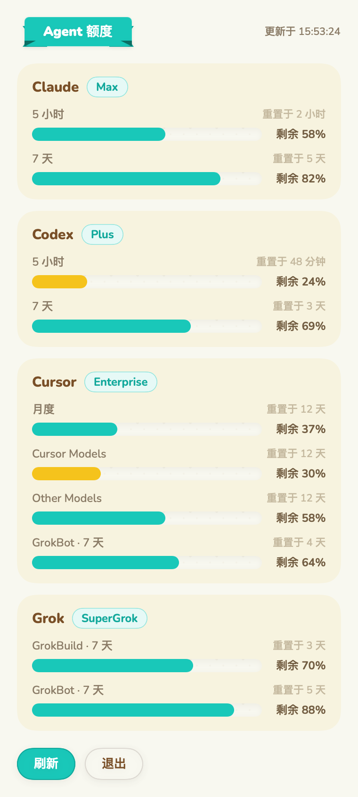
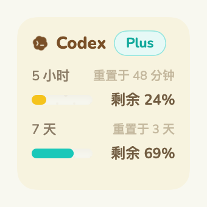
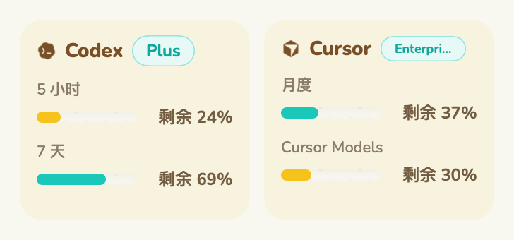
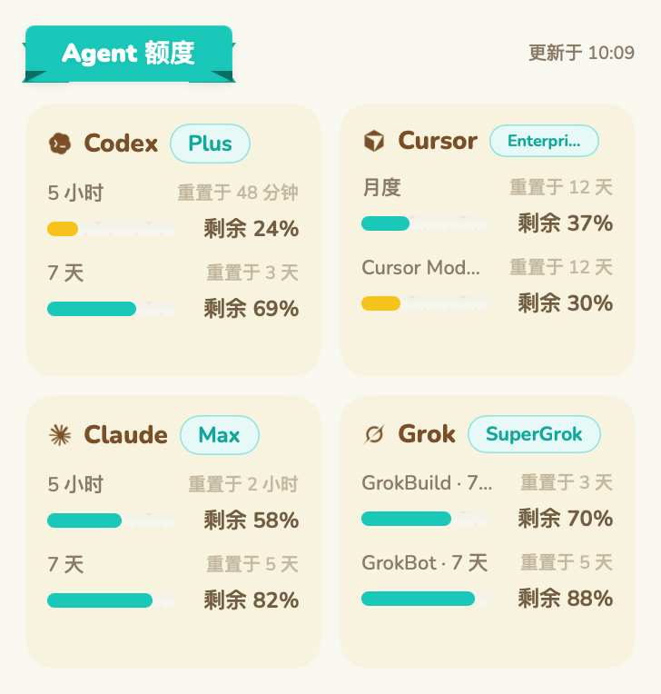
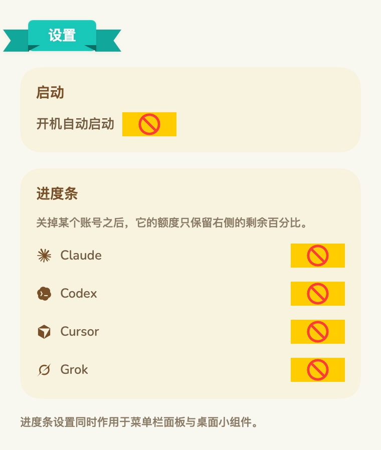

# 狸记额度（Linook）

macOS 菜单栏与桌面小组件，用来看本机各个 Agent 账号的额度剩余。

旧名 AiLimits。源码里的模块与目标名仍然沿用 `AiLimits*`，不影响使用。

支持 Claude、Codex、Cursor、Grok 四种账号。凭据从本机已经登录的客户端里读取，再向各自的官方接口查询额度，过程中不需要手动填写任何密钥。

## 界面

菜单栏下拉面板：



桌面小组件：






设置页面：



图片由样例数据离屏渲染，不含真实账号信息。

## 功能

- **菜单栏面板**：点开菜单栏图标是一个下拉面板，每种账号各占一张卡片，列出 5 小时、7 天、月度等各个额度的剩余百分比、重置时间与套餐类型。进度条与数字都是剩余量，数字前标注「剩余」。
- **菜单栏常驻项**：轮流展示每个账号自己剩余最多的一份额度，图标与数字一起切换，每 6 秒换一个账号，几个账号的余量都能扫到。只有一个账号有数据时保持不动。
- **设置**：面板底部的「设置」打开设置窗口，可以开关开机自动启动，也可以关掉整个账号或者其中某一份额度（例如 Cursor 的「月度」「GrokBot」）；关掉的内容从菜单栏面板、桌面小组件与菜单栏常驻项里一起消失，一个账号的额度全部关掉时整张卡片也不再出现。
- **桌面小组件**：支持单格、双格、四格三种尺寸，按消耗最高的账号排在前面。开启系统里的「调暗桌面小组件」之后内容照常显示。
- **自动刷新**：启动时先显示已有的成功快照，再读取实时额度。正常情况下每 5 分钟刷新；读取失败后每 30 秒再试。短暂断网或服务端故障会在同一次读取中重试，最多请求 3 次。

## 支持的账号

**Claude**

- 凭据：钥匙串 `Claude Code-credentials`，其次 `~/.claude/.credentials.json`
- 额度接口：`api.anthropic.com/api/oauth/usage`
- 除了 5 小时与 7 天两个窗口，还会列出按模型划分的每周额度

**Codex**

- 凭据：`$CODEX_HOME/auth.json`，默认 `~/.codex/auth.json`
- 额度接口：`chatgpt.com/backend-api/wham/usage`
- 接口给出的主次窗口按窗口长度对应到 5 小时与 7 天

**Cursor**

- 凭据：钥匙串 `cursor-access-token`，其次 `~/.cursor/auth.json`、`~/.cursor/cli-config.json`，以及 Cursor 桌面端的 `state.vscdb`
- 额度接口：`cursor.com/api/usage-summary`
- GrokBot 的每周额度由 Cursor 账号后台一并给出，地址是 `api2.cursor.sh/aiserver.v1.DashboardService/GetSandUsageStatus`；账号没有 GrokBot 额度时这一项不显示

**Grok**

- 凭据：`$GROK_HOME/auth.json`，默认 `~/.grok/auth.json`
- 额度接口：`cli-chat-proxy.grok.com/v1/billing`，可用环境变量 `GROK_CLI_CHAT_PROXY_BASE_URL` 换到别的地址
- GrokBot 是独立于 GrokBuild 的另一份额度，读数来自 Grok Bot 桌面应用写在 `~/Library/Application Support/Grok Bot/sand-client-persistence` 的用量缓存。缓存里的有效期或者重置时间已经过去时不再展示，打开桌面上那个应用就会刷新
- 自动续期：`auth.x.ai` 签发的令牌即将过期或额度接口返回 401 时，使用本机的 `refresh_token` 静默续期，无需启动 Grok CLI。续期与 CLI 共用 `auth.json.lock`，新凭据以仅当前用户可读写的权限原子写回 `auth.json`。
- 仅当续期授权被撤销、缺少续期凭据或使用不支持的登录来源时，才需要重新登录。临时网络故障不会被提示成「登录已过期」。

任何一个账号取不到数据只会影响它自己的那张卡片，其余账号照常显示。

## 安装

本项目没有付费的 Apple 开发者账号，发布包只做了临时签名（ad-hoc），没有 Developer ID 签名，也没有经过 Apple 公证，所以首次打开要手动放行。

1. 在 [Releases](https://github.com/Wadehl/linook/releases) 下载 `Linook-<版本>-macOS.dmg`（或 `.zip`），把 `Linook.app` 拖进「应用程序」，在系统里显示为「狸记额度」。可以用同一页的 `SHA256SUMS.txt` 核对文件。
2. 去掉下载隔离标记。必须带 `-r`，否则里面的小组件扩展仍然被隔离，小组件不会出现：

   ```bash
   xattr -dr com.apple.quarantine /Applications/Linook.app
   ```

   不想用终端的话：双击打开，被拦下后到「系统设置 → 隐私与安全性」，在页面下方点「仍要打开」，再输入密码确认。macOS 14 也可以在 Finder 里右键 → 打开；macOS 15 起右键打开不再能绕过，只能用「仍要打开」或者上面的命令。
3. 打开「狸记额度」（`Linook.app`）。它只在菜单栏显示图标，没有程序坞图标。

每次升级覆盖安装之后，都要再执行一次第 2 步。

从改名前的 AiLimits 升级：先退出旧应用，把「应用程序」里的 `AiLimits.app` 删掉，再装 `Linook.app`。两者的 bundle id 相同，同时留着会让系统登记两份小组件。已有的快照与设置会继续沿用，不用重新配置。

## 桌面小组件

发布包里的小组件与应用之间不经过应用组共享数据：应用把快照写到 `~/Library/Application Support/AiLimits/snapshot.json`，小组件扩展凭沙盒的只读例外读取这个目录。macOS 15 起系统按开发者团队编号校验应用组，临时签名的小组件扩展访问应用组会被直接拒绝，所以发布包改用这个位置。

面板、菜单栏与小组件共用一份显示设置，写在同一个目录的 `display-settings.json`。文件不存在、还是旧版本写下的、或者缺少某一项时，按全部展示处理。设置里关掉的账号用账号标识记录，关掉的额度用窗口标识记录：5 小时、7 天、月度分别是 `session`、`weekly`、`monthly`，其余额度用接口返回的名称（例如 `Cursor Models`、`GrokBot · 7 天`）。

1. 完成上面的安装，确认已经去掉隔离标记。
2. 打开应用，点开菜单栏面板，等第一次刷新完成。之后应当能看到快照文件：

   ```bash
   ls -l ~/Library/Application\ Support/AiLimits/snapshot.json
   ```

3. 向系统登记小组件扩展，并确认登记成功（输出里有 `com.kevinkwok.AiLimitsWidgetExtension`，并且行首不是表示被忽略的 `-`）：

   ```bash
   pluginkit -a /Applications/Linook.app/Contents/PlugIns/AiLimitsWidgetExtension.appex
   pluginkit -e use -i com.kevinkwok.AiLimitsWidgetExtension
   pluginkit -m -v -i com.kevinkwok.AiLimitsWidgetExtension
   ```

4. 让小组件服务重新读取：

   ```bash
   killall chronod NotificationCenter 2>/dev/null || true
   ```

5. 在桌面空白处右键 →「编辑小组件」，在「狸记额度」下找到「Agent 额度」（也可以直接搜索），选尺寸后拖到桌面。

排查：

- 小组件列表里找不到：多半是扩展还带着隔离标记，或者系统登记了多份。用 `pluginkit -m -D -v -i com.kevinkwok.AiLimitsWidgetExtension` 列出全部登记位置，只应该剩 `/Applications/Linook.app` 里的那一份；其余路径（例如 Xcode 的 DerivedData）删掉对应的 `.app`（包括改名前的 `/Applications/AiLimits.app`），然后重做第 3、4 步。仍然不行就注销重新登录或重启一次。
- 小组件显示没有数据：确认第 2 步的快照文件存在并且在更新。
- 升级之后小组件空白或不再刷新：从桌面移除旧的小组件，重做第 2 到 5 步后重新添加。
- 临时签名的小组件扩展能否在桌面加载，Apple 没有正式承诺。如果在你的系统版本上始终不出现，请用下面的「从源码构建」。

### 从源码构建

在自己的 Mac 上构建，不会带下载隔离标记，小组件也最稳定。需要 Xcode 与 xcodegen（`brew install xcodegen`）。

- 不需要任何 Apple 账号：

  ```bash
  ./scripts/build-release.sh
  ditto dist/Linook.app /Applications/Linook.app
  open /Applications/Linook.app
  ```

  产物与发布包相同（临时签名，小组件走 `~/Library/Application Support/AiLimits/`），然后按上面「桌面小组件」的第 2 到 5 步操作。

- 用自己的团队编号签名，小组件改走应用组。免费的 Apple ID 也可以：在 Xcode →「设置 → 账户」登录 Apple ID，会得到一个 Personal Team，团队编号可以在钥匙串里 `Apple Development` 证书的「组织单位」一栏看到。然后：

  ```bash
  DEVELOPMENT_TEAM=你的团队编号 ./scripts/build-app.sh
  ```

  应用组标识会按团队编号自动生成为 `<团队编号>.group.com.kevinkwok.ailimits`。免费账号签出的应用只能在本机使用，证书过期后需要重新构建。这条路线还没有在免费账号上实测过，遇到签名报错时改用上面不需要账号的方式。

## 构建

需要 macOS 14 以上、带 Swift 6 工具链的 Xcode，以及 xcodegen。

```bash
brew install xcodegen
./scripts/build-app.sh
```

脚本会生成 `AiLimits.xcodeproj`、构建 Release、把产物安装到 `/Applications/Linook.app`（如果还有改名前的 `/Applications/AiLimits.app` 会一并移除），并向 LaunchServices 注册小组件扩展。

签名使用的是 `project.yml` 里的 `DEVELOPMENT_TEAM`，也可以用环境变量 `DEVELOPMENT_TEAM` 覆盖。macOS 要求应用组的标识前面带上开发者团队编号，应用组标识由 `project.yml` 的 `AILIMITS_APP_GROUP` 按团队编号生成，并写进应用与小组件的 Info.plist，`SnapshotStore` 从那里读取。

小组件读取快照的位置由构建设置 `AILIMITS_SHARED_STORAGE` 决定：默认 `appGroup` 走应用组共享目录；`scripts/build-release.sh` 与 CI 用 `local`，走 `~/Library/Application Support/AiLimits/`，并去掉应用组权限。

## 自动构建与发布

- `.github/workflows/build.yml`：每个 PR 与 main 分支的推送都会跑 `swift test`，再用 `scripts/build-release.sh` 做一次临时签名构建，检查小组件扩展能否被系统登记，安装包作为构建产物保留 14 天。
- `.github/workflows/release.yml`：推送 `v*` 标签时构建通用二进制（Apple 芯片与 Intel），生成 `Linook-<版本>-macOS.zip`、`Linook-<版本>-macOS.dmg` 与 `SHA256SUMS.txt`，并发布到 GitHub Releases；版本号取自标签。也可以在 Actions 页面手动运行，手动运行只上传构建产物，不发布。

发布新版本：

```bash
git tag v0.2.1
git push origin v0.2.1
```

应用本身不开启沙盒，因为它需要读取 `~/.claude`、`~/.codex`、`~/.cursor`、`~/.grok` 这些目录；小组件扩展按照系统要求开启了沙盒，只通过应用组共享目录拿到数据。

## 开发

```bash
swift build
swift test
./scripts/render-widget-preview.sh
```

`render-widget-preview.sh` 把三种尺寸在三种绘制方式与底色下离屏渲染成 PNG，输出到 `logs/widget-preview`，用来在没有桌面小组件的环境里检查版面。

README 里的面板与设置页图片由构建好的应用离屏渲染，参数是要写入的文件路径：

```bash
/Applications/Linook.app/Contents/MacOS/Linook --render-panel docs/images/panel.png
/Applications/Linook.app/Contents/MacOS/Linook --render-settings docs/images/settings.png
```

两者都使用样例数据，不读取本机账号。

## 项目结构

- `Sources/AiLimitsCore` — 额度模型、四种账号的凭据读取与额度查询、应用组共享文件的读写
- `Sources/AiLimitsUI` — 设计系统的配色与字体、进度条、小组件版面
- `Sources/AiLimitsApp` — 菜单栏应用与下拉面板
- `Sources/AiLimitsWidget` — 桌面小组件扩展
- `Sources/AiLimitsWidgetPreview` — 把小组件版面离屏渲染成 PNG 的命令行工具
- `Tests` — 版面规则与配色的单元测试

## 隐私

- 凭据仅用于对应服务的额度查询与登录续期。Grok 续期请求只发送到经过验证的 `https://auth.x.ai` 地址，新凭据写回本机原有的 `auth.json`，供仪表盘与 CLI 共用。
- 共享快照包含额度和账号标签，不包含访问令牌或续期令牌。
- 没有统计、上报与联网的账号体系。

## 参考与致谢

- 额度信息的获取方式参考 [orca](https://github.com/stablyai/orca)
- 界面设计取自 [animal-island-ui-style](https://github.com/guokaigdg/animal-island-ui-style)
- 界面风格参考 [animal-island-ui](https://github.com/guokaigdg/animal-island-ui)（MIT License）
- 账号图标取自 [LobeHub 图标库](https://github.com/lobehub/lobe-icons)，按 MIT 许可证使用，许可证见 `Resources/ProviderIcons/LobeHub-LICENSE.txt`
- 界面字体是 [Nunito](https://fonts.google.com/specimen/Nunito)，按 SIL Open Font License 1.1 使用，许可证见 `Resources/Nunito-OFL.txt`

## 许可证

MIT，见 `LICENSE`。
